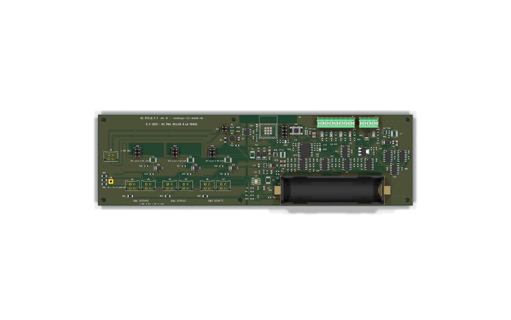

# essensys-i2c-etoile-0v – carte N2 « étoile 0 V » sur rail DIN

Carte qui relie le boîtier principal (BP, carte SC944D) aux boîtiers auxiliaires (BA1 SC940D, BA2 SC941C,
BA3 SC942C) d'une installation Essensys **en étoile** autour d'un plan 0 V commun, à la place du chaînage d'origine.
Depuis la révision B, elle porte aussi un module ESP32 qui écoute le bus sans pouvoir y émettre, surveille ses
tensions, horodate les surtensions et gère une alarme intrusion sur batterie (voir [Révision B](#révision-b--module-esp32-espion-et-alarme)).



## Contexte : foudre 2026

Un coup de foudre indirect (août 2026) a détruit des étages I2C entre le BP et les BA : la surtension induite fait
circuler un courant d'équilibrage dans le 0 V du chaînage BP → BA1 → BA2 → BA3, et les écrêteurs des lignes SDA/SCL
conduisent dès que la chute de tension sur ce 0 V devient trop forte. Analyse et retour d'expérience :
[synthèse RETEX foudre 2026](https://www.essensys.fr/docs/retex/foudre-2026/synthese/).

N2 est la mesure « court terme » côté câblage : raccourcir et doubler les chemins 0 V, isoler chaque BA (cavalier, PTC, TVS).

- Change OpenSpec : [`i2c-surge-protection-2026-10-007`](https://github.com/essensys-hub/essensys-board-SC944D/tree/feat/i2c-surge-protection-2026-10-007/openspec/changes/i2c-surge-protection-2026-10-007)
  dans essensys-board-SC944D, tâche 4.1 (sections D3/D4 de `design.md`, spec `aux-box-interconnect`).
- Ticket : [essensys-hub/essensys-board-SC944D#1](https://github.com/essensys-hub/essensys-board-SC944D/issues/1).

## Fonction

N2 remplace le chaînage BP → BA1 → BA2 → BA3 par une **étoile** : le bus du BP (J31) arrive sur la carte
et repart vers chaque BA par un port dédié. Le 0 V de chaque BA rejoint celui du BP par un **plan 0 V double face**,
avec deux faisceaux AWG20 par BA (J1 et J2 du BA). Le 0 V du BP est doublé par une queue de cochon AWG20
soudée sur la broche traversante J31-3. But : relever le seuil de courant d'équilibrage à partir duquel
les écrêteurs I2C conduisent (au moins 4 fois la référence, à mesurer en 4.3), et garder l'écart statique de 0 V
sous 0,05 V.

Par port BA :

- **cavalier JPn** (embase 2×3 au pas de 2,54 mm, 3 shunts) qui coupe SDA, SCL et +15 V ; le 0 V n'est jamais coupé.
  Un pont 2×3 (boîtier femelle 2×3 avec 3 boucles) permet d'ouvrir les trois lignes en une seule manœuvre ;
- **PTC Fn** (CMS 1812, 30 V au moins) sur le +15 V, **puis TVS Dn SMAJ16A** entre le +15 V du port et le 0 V.
  Une TVS en court-circuit ne fait déclencher que la PTC de son port : les autres BA restent alimentés.

Partie bus : aucun composant actif, aucun firmware, aucune retouche des BA.

## Brochage (WR-MPC3 2×2, compatible Würth 66200421122)

| Broche | Signal |
|---|---|
| 1 | SDA |
| 2 | SCL |
| 3 | 0 V |
| 4 | +15 V |

| Repère | Rôle |
|---|---|
| J1 | Entrée BP, vers J31 du BP |
| J8 | Pastille (Ø 1,25 mm) pour la queue de cochon AWG20 vers J31-3 du BP |
| J2 / J3 | BA1 SC940D, vers J1 / J2 du BA |
| J4 / J5 | BA2 SC941C, vers J1 / J2 du BA |
| J6 / J7 | BA3 SC942C, vers J1 / J2 du BA |
| JP1 / JP2 / JP3 | Cavalier du port BA1 / BA2 / BA3 (impairs côté BP, pairs côté port) |
| F1–F3, D1–D3 | PTC puis TVS du +15 V de chaque port |
| H1–H4 | Trous M3 non métallisés, **non reliés** (fixation sur support DIN isolant) |

Nets : `SDA_BP`, `SCL_BP`, `+15V_BP`, `0V` ; par port `SDA_BAn`, `SCL_BAn`, `+15V_SWn` (après cavalier), `+15V_BAn` (après PTC).

## Carte

- **235 × 68 mm** (révision B ; zone bus 110 mm à gauche, zone module à droite), FR-4 1,6 mm, 2 couches,
  **cuivre 2 oz (70 µm) demandé**, HASL, vernis vert, sérigraphie blanche. Six trous M3 non reliés.
- Plan 0 V sur les deux faces (raccord plein, sans thermique), vias de couture, liaison J31-3 → pastille J8 en piste de 3 mm.
- Pistes : +15 V 1,5 à 2 mm, SDA/SCL 0,5 mm ; tronc en peigne depuis J1, une descente par port.
- Support DIN : à monter sur un porte-carte DIN **isolant** (profilé plastique pour carte de 68 mm, ou entretoises nylon M3 sur adaptateur DIN). Les trous de fixation ne sont reliés à rien.
- Zone module : plan GND sur les deux faces, vias de couture, zone sans cuivre sous l'antenne de l'ESP32 (bord haut).
  Pistes 0,25 mm (signaux), 0,4 mm (3,3 V) et 0,6 mm (puissance), vias 0,6/0,3 mm, isolement 0,2 mm.

## Révision B : module ESP32 espion et alarme

Change OpenSpec [`n2-esp32-spy-alarm-2026-10-008`](openspec/changes/n2-esp32-spy-alarm-2026-10-008),
ticket [essensys-hub/essensys-feature-lifecycle#28](https://github.com/essensys-hub/essensys-feature-lifecycle/issues/28).
Tâches matérielles couvertes ici : 1.1, 1.2, 1.3 (conception), 2.1 et 2.2 (conception, essais sur banc à faire).
Le firmware est dans `firmware/` (autre lot du même change).

La révision B ajoute à droite de la carte une **zone module** qui observe le bus sans pouvoir agir dessus,
surveille ses tensions, horodate les surtensions et gère une alarme intrusion sur batterie.
La zone bus (révision A, à gauche) est inchangée : seuls s'y ajoutent les prises de mesure, le cavalier d'écoute
et l'alimentation de l'isolateur.

### Séparation bus / module

- Deux plans distincts : **0 V** (zone bus, x < 110,3 mm) et **GND** (zone module, x > 111,7 mm), séparés par un sillon
  de 1,4 mm repéré en sérigraphie. GND rejoint le 0 V **en un seul point**, par le net-tie NT1.
- Rien n'est relié au PE : trous M3 non métallisés, aucune borne de terre. La sérigraphie TBTS est conservée
  sur les deux faces (« 0 V TBTS – NE PAS RELIER À LA TERRE », « ZONE MODULE (GND) – TBTS – AUCUNE LIAISON AU PE »).
- Seuls traversent le sillon (vérifié sur le PCB routé) : l'isolateur U1 (à cheval), NT1, le +15V_BP vers la PTC
  propre F4 du module, et les 13 lignes de mesure (MEAS_*, DA_*) **déjà limitées en courant** par leur résistance
  de prise, placée côté bus au plus près du point mesuré (150 kΩ pour les +15 V, 100 kΩ pour les prises Kelvin 0 V).

### Composants retenus

| Fonction | Repères | Référence | Remarque |
|---|---|---|---|
| MCU Wi-Fi | U6 | ESP32-C3-MINI-1-N4 | Antenne en bord de carte, zone interdite cuivre de 43 × 6,4 mm (D1) |
| Isolateur d'écoute | U1 | **ISO7720DR** (TI), 2 canaux **même sens** | Seconde source broche à broche : ADuM1200ARZ (2/0) |
| LDO côté bus de l'isolateur | U2, R3 | LP2950-5.0 (TO-92, VIN 30 V) + 100 Ω | Alimenté par +15V_BP, indépendant du module |
| Cavalier d'écoute | JP4 | Embase 2×2, 2 shunts | Retirés : aucune liaison module ↔ SDA/SCL |
| RTC | U7, C20 | RV-3028-C7 (I2C 0x52) + supercondensateur 11 mF (CPH3225A) | EVI relié au latch 0 V : horodatage matériel |
| ADC | U10–U13 | 4 × MCP3428 (16 bits, réf. interne 2,048 V, entrées différentielles) | Bus I2C local du module |
| Amplis différentiels | U9 | TLV9064 (RRIO, 10 MHz) | 3 canaux G = 0,249 + tampon VREF |
| Latch surtension | U14, U15, U16 | 2 × LM339 + 74HC74 | Réarmé par GPIO7 |
| Extension d'E/S | U8 | TCA9534 (I2C 0x20) | Latches, chargeur, clé, secteur, LED |
| PTC propre, anti-retour, TVS | F4, D4, D5 | PTC 1812 0,2 A, SS14, SMAJ16A | Défaut du module = F4 ouverte, BA alimentés |
| Abaisseur 15 → 5 V | U3, L1 | AP63205WU (5 V fixe, 3,8–32 V) + 4,7 µH | |
| Chargeur LiFePO4 | U4, TH1 | CN3058E (CC/CV 3,6 V), RISET 9,1 kΩ = 200 mA, CTN 10 kΩ B3435 | Charge autorisée ≈ 3–43 °C |
| Power-path | D6, Q1 | SS14 (secteur) + AO3401A (batterie) | Basculement sans coupure par la diode de structure de Q1 |
| LDO 3,3 V | U5 | AP2112K-3.3 | |
| Batterie | BT1, F5 | Porte-pile Keystone 1042 + IFR18650 1,5 Ah, PTC 1,5 A | |
| Entrées alarme | J10, R71–R78, D11–D14 | 4 boucles équilibrées, 1 kΩ série, SMF5.0A | FDL 2 × 4,7 kΩ |
| Clé d'armement | J11, R79, R80, D15 | Contact sec | |
| Sirène 12 V | U17, L2, D7, U18, D16 | MT3608 (boost 12 V depuis VBAT) + **BTS4140N** (high-side protégé) | Boost et sortie coupés au reset |

**Choix de l'isolateur.** L'ISO7721 et l'ADuM1201 ont un canal dans chaque sens : leur canal retour piloterait
une sortie côté bus, exactement ce que la spec interdit. Ils ne conviendraient qu'en n'utilisant qu'un canal
par boîtier (deux boîtiers, un canal retour inutilisé mais physiquement présent). L'**ISO7720** a ses deux canaux
dans le sens bus → module : côté bus il n'existe que des **entrées CMOS** (≈ 2 pF, fuite typique de quelques nA,
10 µA max en datasheet), aucune sortie. Aucune configuration logicielle ne peut donc tirer SDA ou SCL. Sa sortie
est « fail-safe haute » (niveau repos d'I2C). Le côté bus est alimenté en 5 V (niveau du bus du BP) par U2,
ce qui garde les entrées dans leur plage même quand le module est éteint.

### Raccordement firmware (ESP32-C3)

| GPIO | Net | Rôle |
|---|---|---|
| 0 | SNF_SCL | Écoute SCL (sortie OUTB de l'isolateur), entrée seule |
| 1 | SNF_SDA | Écoute SDA (OUTA), entrée seule |
| 2 | IO2 | Broche de démarrage, tirage haut 10 kΩ, libre |
| 3 | EXP_INT | /INT du TCA9534 (réveil possible) |
| 4 / 5 | I2C_SDA / I2C_SCL | Bus I2C **local** du module (4,7 kΩ), distinct du bus espionné |
| 6 | SIREN_EN | Active le boost et la sortie sirène (tirage bas 100 kΩ) |
| 7 | LATCH_RST | Réarmement des latches, actif bas (tirage haut 10 kΩ) |
| 8 | LED_STAT | LED verte, active basse (broche de démarrage, tirage haut) |
| 9 | BOOT | Bouton SW1 (démarrage / service) |
| 10 | RTC_INT | /INT du RV-3028 |
| 18 / 19 | USB_DM / USB_DP | Débogage USB (J9) |
| 20 / 21 | U0RX / U0TX | Débogage UART (J9) |

TCA9534 (0x20) : P0 LATCH_0V, P1 LATCH_OV, P2 /CHRG, P3 /DONE, P4 ARM_IN (bas = clé fermée),
P5 PG_5V (haut = secteur présent), P6 LED rouge (active basse), P7 libre (tirée bas).

MCP3428 (adresses selon la table de la datasheet, à confirmer par un scan I2C au banc, plage 0x68–0x6F) :

| Repère | Adr0 / Adr1 | CH1 | CH2 | CH3 | CH4 |
|---|---|---|---|---|---|
| U10 | 0 / 0 | +15V_BP | +15V_SW1 (amont PTC F1) | +15V_SW2 | +15V_SW3 |
| U11 | 1 / 0 | +15V_BA1 (aval PTC F1) | +15V_BA2 | +15V_BA3 | VBAT (÷ 2) |
| U12 | 0 / 1 | Boucle Z1 | Z2 | Z3 | Z4 |
| U13 | 1 / 1 | Écart 0 V port BA1 (CH− = VREF) | BA2 | BA3 | Sortie sirène (÷ 11) |

Le RV-3028 doit être configuré par le firmware : chargeur d'entretien (trickle) activé vers VBACKUP,
basculement automatique sur VBACKUP, entrée EVI sur front montant (horodatage du latch « écart de 0 V »).

### Tolérances des chaînes de mesure (tâche 1.2)

Hypothèses : résistances de mesure 0,1 % 25 ppm/°C, échauffement de 30 °C, MCP3428 à 15 éch./s
(16 bits, LSB 62,5 µV, erreur de gain 0,35 % max, offset 15 µV, réf. 15 ppm/°C), TLV9064 offset 1,6 mV max,
LM339 offset 5 mV max. « Pire cas » = somme des erreurs maximales ; « RSS » = somme quadratique.
La colonne « Résolution » suppose le mode 16 bits ; en 12 bits (240 éch./s, mode choisi par le firmware)
elle devient 16 mV sur les +15 V, 2 mV sur VBAT et 4 mV sur l'écart de 0 V, sans changer les erreurs de gain.

| Chaîne | Rapport, pleine échelle | Résolution | Pire cas | RSS | Remarque |
|---|---|---|---|---|---|
| +15 V amont/aval des PTC (7 canaux) | 10 k / (150 k + 10 k) = 1/16 ; 32,8 V | 1,0 mV | ± 0,72 % (± 0,11 V à 15 V) | ± 0,43 % (± 0,07 V) | Charge de l'ADC (2,25 MΩ) : − 0,42 % systématique, corrigée par le firmware ; sans correction ± 1,14 % (± 0,17 V) |
| VBAT | 1/2 ; 4,1 V | 0,13 mV | ± 0,9 % (± 32 mV à 3,6 V) | ± 0,6 % | Charge de l'ADC − 2,2 % systématique, corrigée ; seuil « batterie faible » 3,0 V |
| Écart de 0 V (3 canaux) | G = 24,9 k / 100 k = 0,249 ; − 4,0 V … + 8,2 V | 0,25 mV | ± (8 mV + 0,6 % de la lecture) | ± (4 mV + 0,4 %) | Offset dominé par le TLV9064 ; avec un zéro mesuré à la mise en service : ± (1 mV + 0,6 %). Objectif 4.3 (≤ 0,05 V) mesurable |
| Seuil du latch « écart de 0 V » | ± 1,00 V (fenêtre VREF ± 0,249 V) | – | ± 0,06 V | ± 0,03 V | Comparateurs ± 32 mV, ampli ± 8 mV, tampon VREF ± 6 mV, échelle ± 12 mV ; impulsion mini ≈ 1–2 µs (onde 8/20 µs captée) |
| Seuil du latch « surtension +15 V » | 16 × 1,249 V = 20,0 V | – | ± 0,15 V | ± 0,09 V | Filtre 9,4 kΩ / 100 pF (τ ≈ 0,9 µs) ; impulsion mini ≈ 2 µs |
| Boucles d'alarme | 3,3 V, 10 kΩ + 1 kΩ série | 0,06 mV | ± 4 % par état | – | FDL 5 %, 3,3 V ± 2 %, voir les seuils ci-dessous |
| Sortie sirène | 1/11 ; 22,5 V | 0,7 mV | ± 0,7 % | – | Détection de court-circuit (sortie < 6 V sirène active) |

Boucles équilibrées (FDL 4,7 kΩ en série avec le contact + 4,7 kΩ en parallèle) :

| État | Résistance de boucle | Tension mesurée | Seuils proposés |
|---|---|---|---|
| Court-circuit (sabotage) | 0 Ω | 0,30 V | < 0,75 V |
| Repos (fermée) | 4,7 kΩ | 1,20 V (1,15–1,25) | 0,75–1,44 V |
| Alarme (ouverte) | 9,4 kΩ | 1,68 V (1,61–1,75) | 1,44–1,95 V |
| Coupée (sabotage) | ∞ | saturation (≥ 2,047 V) | > 1,95 V |

Détection « PTC déclenchée » : aval < 2 V alors que l'amont est > 12 V (une PTC déclenchée laisse
quelques volts au plus). La chute normale dans une PTC (≈ 0,05 à 0,2 V) est du même ordre que l'erreur de deux
canaux : le module ne mesure pas le courant des départs, il détecte le déclenchement.

### Budget de consommation (calcul, mesure en tâche 2.3)

Charges du rail 3,3 V (moyennes) : ESP32-C3 Wi-Fi en économie et décodage I2C actif ≈ 40 mA (crête 350 mA
en émission), analogique et logique ≈ 7,8 mA (TLV9064 2,2 mA, 2 × LM339 1,6 mA, ISO7720 côté module
1,2 mA, 4 × MCP3428 0,6 mA, 4 boucles au repos 0,84 mA, LED 1,3 mA, échelle de seuils 0,1 mA).

| Cas (sur +15 V, rendement de l'abaisseur 85 %) | 5 V | +15 V |
|---|---|---|
| Batterie pleine, Wi-Fi en économie | 48 mA | 19 mA |
| **Batterie vide** (charge 200 mA) + Wi-Fi en économie | 248 mA | **97 mA** |
| Batterie vide + émission Wi-Fi (crête de quelques ms) | 560 mA | 220 mA |
| Côté bus : LP2950 + isolateur + 7 diviseurs de mesure | – | 2,3 mA |
| **Total pire cas en régime établi** | | **≈ 100 mA (1,5 W)** |

- La sirène est alimentée par **VBAT** (boost MT3608) et non par le +15 V : 12 V × 0,2 A ≈ 0,9 A sur la batterie
  pendant 3 min au plus (≈ 44 mAh), sans effet sur le +15 V du bus.
- F4 (Ihold 0,2 A à 23 °C, ≈ 0,16 A à 50 °C) tient les 100 mA établis ; les crêtes Wi-Fi de quelques ms
  ne la font pas déclencher (constante thermique de l'ordre de la seconde).
- Le +15 V du BP doit fournir ces ≈ 100 mA **en plus** des BA : à reporter dans le dimensionnement
  PTC ≥ 1,5 × BA_ALIM (design D7), vérification en 2.3.

Autonomie sur batterie (1,5 Ah, 80 % utilisables = 1,2 Ah ; sur batterie le BP a coupé le +15 V,
il n'y a plus de trafic I2C à décoder) :

| Profil firmware | Courant moyen | Autonomie |
|---|---|---|
| Wi-Fi actif en permanence (≈ 80 mA) | 88 mA | 14 h |
| Wi-Fi en économie, CPU actif (≈ 40 mA) | 48 mA | 25 h |
| Veille légère + DTIM, alarme armée (≈ 10 mA) | 18 mA | 67 h |

L'objectif de 24 h (tâche 5.4) suppose un firmware en économie d'énergie sur batterie (≤ 50 mA en moyenne).

## Fichiers

| Fichier | Contenu |
|---|---|
| `n2-etoile-0v.kicad_pro/.kicad_sch/.kicad_pcb` | Projet KiCad 9 |
| `n2-etoile-0v.kicad_sym`, `sym-lib-table`, `fp-lib-table` | Symboles propres (ESP32-C3-MINI-1, CN3058E) et tables de bibliothèques du projet |
| `export/n2-etoile-0v-schema.pdf` | Schéma |
| `export/n2-etoile-0v-bom.csv` | BOM |
| `export/n2-etoile-0v-gerber.zip` | Gerber, perçages Excellon, plan de perçage, job Gerber |
| `export/n2-etoile-0v-pcb-{top,bottom}.{png,svg}` | Rendus 3D et tracés cuivre |
| `rapports/erc.rpt`, `rapports/drc.rpt` | ERC et DRC (avec parité schéma) : 0 erreur, 0 avertissement |
| `scripts/` | Générateurs Python et `build.sh` : `n2_module.py` (composants et nets du module, source unique), `gen_sch.py`, `gen_pcb.py` (placement), `autoroute.py` (routeur maillé déterministe avec arrachage ciblé et réparation des plans), `fill_zones.py` |

## Régénérer

Prérequis : KiCad 9 installé dans `/Applications/KiCad` (macOS ; adapter `KC` et `KP` dans `scripts/build.sh` sinon).

```sh
sh scripts/build.sh
```

Le script régénère schéma et PCB (le routage du module prend environ 5 minutes), relance ERC et DRC
(avec parité schéma), refait tous les exports et échoue si ERC ou DRC signalent une erreur.
Seule exception ERC, déclarée dans le projet : la règle « broche GND non reliée à un net de masse » est ignorée,
car la masse du bus s'appelle `0V` (ISO7720 GND1, LP2950).

## BOM

Nomenclature complète (révision B) : [`export/n2-etoile-0v-bom.csv`](export/n2-etoile-0v-bom.csv).
Partie bus (révision A) :

| Repères | Qté | Composant | Note |
|---|---|---|---|
| J1–J7 | 7 | Embase WR-MPC3 2×2 verticale THT, Würth 66200421122 (empreinte Molex Micro-Fit 3.0 43045-0412) | |
| F1–F3 | 3 | PTC CMS 1812, 30 V au moins, ex. Littelfuse 1812L050/30MR | Courant de maintien à fixer (voir limites) |
| D1–D3 | 3 | TVS SMAJ16A (SMA) | |
| JP1–JP3 | 3 | Embase mâle 2×3, pas de 2,54 mm | + 9 shunts, ou 3 ponts 2×3 |
| J8 | – | Pastille, pas de composant | Queue de cochon AWG20 |
| – | 1 | Porte-carte DIN isolant + 4 vis/entretoises M3 nylon | Hors BOM KiCad |

Faisceaux (tâche 4.2) : 7 cordons AWG20 2×2 WR-MPC3 femelle des deux côtés, 15 cm au plus, sertis à l'outil.

## Consignes de pose

- **Le 0 V n'est jamais relié au PE** : pas de borne PE sur la carte ni dans le coffret domotique, support DIN isolant,
  aucune vis de fixation reliée au 0 V.
- Faisceaux AWG20 de **15 cm au plus**, isolés, ni vert-jaune ni bleu clair, repérés aux deux extrémités des liaisons 0 V :
  **« 0 V TBTS – NE PAS RELIER À LA TERRE »**.
- La queue de cochon vers J31-3 est soudée sur la broche traversante pendant la dépose du BP, jamais sur une pastille CMS,
  avec un arrêt de traction ; elle est repérée comme les autres liaisons 0 V.
- Câbler **J1 et J2 de chaque BA** (les deux faisceaux comptent dans le seuil). Ne plus chaîner les BA entre eux.
- Déconnecter un BA : ouvrir JPn (SDA, SCL et +15 V coupés, 0 V conservé), sans toucher au câblage 230 V.
- Ne jamais piloter une armoire réelle pendant les essais.

## Consignes TBTS

Le bus BP/BA est en TBTS (+15 V) : voir les consignes de pose ci-dessus (0 V isolé du PE, repérage, support isolant).
Aucune intervention dans le coffret sans coupure de l'alimentation 230 V par une personne habilitée.

## Vérifications restantes (banc)

Carte d'étoile (révision A, tâches 4.2 à 4.4 du change parent) :

- **4.2** faisceaux : moins de 60 mΩ par conducteur, contacts compris ; repérage contrôlé.
- **4.3** seuil d'équilibrage en onde 8/20 et sur un front de 1 Ipk/µs : au moins 4 fois la référence de la chaîne d'origine ;
  écart statique de 0 V entre J31-3 du BP et J1-3 de chaque BA d'au plus 0,05 V à consommation maximale.
- **4.4** sélectivité des PTC : sortie en court-circuit 60 s, autres sorties à 14 V ou plus en 5 s sans déclencher le BP ;
  autres BA de nouveau acquittés moins de 10 s après ouverture du cavalier ; remontée en 120 s au plus ;
  aucun déclenchement en 24 h à 50 °C à consommation maximale.

Module ESP32 (révision B), essais sur banc **sans armoire réelle** :

- **2.1** alimentation : +5 V et +3,3 V dans la tolérance de 0 à 100 mA ; court-circuit franc du +15V_M puis du
  +5 V : F4 s'ouvre et le +15 V des BA reste ≥ 14 V (aucun port BA ne décroche).
- **2.2** batterie : charge CC/CV à 200 mA puis 3,6 V (± 1,5 %), arrêt hors 0–45 °C (CTN chauffée/refroidie),
  coupure du +15 V pendant le décodage I2C et l'émission Wi-Fi : aucun redémarrage du module (journal de reset).
- **2.3** courant pire cas sur le +15 V (batterie vide, Wi-Fi en émission) sous le budget ci-dessus, aucune PTC déclenchée.
- **8.1** NR-i2c-etoile-0v-1 : niveaux et temps de montée de NR-board-sc944d-1 avec module alimenté, non alimenté
  et firmware forçant ses broches ; vérifier aussi le cas « +15 V coupé, SDA/SCL toujours tirées par le BP »
  (voir les limites).

## Limites

Carte d'étoile (révision A) :

- **Empreintes à vérifier** sur les fiches techniques avant fabrication : la WR-MPC3 66200421122 est placée avec l'empreinte
  Molex Micro-Fit 3.0 43045-0412 (pas de 3 mm, deux plots de centrage Ø 1,02 mm) ; numérotation des broches à contrôler
  face au brochage du BA (1 SDA, 2 SCL, 3 0 V, 4 +15 V) et à l'orientation du détrompeur.
- **PTC** : la référence 1812L050/30MR est indicative. Le courant de maintien à 50 °C doit valoir au moins 1,5 fois le
  courant de BA_ALIM d'un BA relais collés (design D3) ; à mesurer, puis à valider en 4.4. Si aucune PTC 1812 ne convient,
  changer l'empreinte (radiale).
- Le cavalier à 3 shunts demande trois gestes ; pour la « manœuvre unique » de la spec, utiliser un pont 2×3.
- Cuivre 2 oz : à préciser à la commande (non porté par l'empilage KiCad, seulement par la sérigraphie de fabrication).
- Pas de TVS de données sur SDA/SCL (non demandée pour N2) ; modèles 3D non vérifiés.

Module (révision B) :

- **Routage automatique** (routeur maison `scripts/autoroute.py`, ERC/DRC à zéro) : à relire par un humain avant
  fabrication, en particulier les boucles de commutation de l'abaisseur (C5/U3/L1/C8) et du boost (U17/L2/D7/C55),
  les pistes qui passent sous le porte-pile et la longueur des lignes de mesure DA_* (haute impédance, ~100 mm).
- **Empreintes à vérifier** : l'ESP32-C3-MINI-1 utilise le motif `ESP32-C6-MINI-1` de KiCad (même boîtier
  13,2 × 16,6 mm, 53 pastilles, pas de 0,8 mm ; comparé à la fig. 11-1 de la datasheet C3-MINI-1 v2.2) ;
  le supercondensateur CPH3225A est posé sur une empreinte 1210 générique.
- **CN3058E** : brochage (1 TEMP, 2 ISET, 3 GND, 4 VIN, 5 BAT, 6 /DONE, 7 /CHRG, 8 FB, EP GND), formule
  ICH = 1800 V / RISET et liaison FB–BAT à confirmer sur la datasheet Consonance avant commande.
- **BTS4140N** : vérifier la tension de fonctionnement minimale à 12 V et la limitation de courant réelle ;
  la tenue au court-circuit de la sortie sirène est à mesurer (tâche 5.2).
- **Isolateur hors tension** : si le BP coupe le +15 V mais garde SDA/SCL tirées à 5 V, les entrées de l'ISO7720
  non alimentées peuvent être rétro-alimentées à travers les 1 kΩ (diodes de protection vers VCC1). À mesurer
  en NR-i2c-etoile-0v-1 ; parade possible sans changer le PCB : 10 kΩ au lieu de 1 kΩ (entrée ≈ 2 pF, τ ≈ 20 ns)
  ou retrait de JP4.
- **Adresses des MCP3428** et ordre des canaux à confirmer par un scan I2C au banc.
- **Autonomie** : ≥ 24 h seulement avec un firmware en économie d'énergie sur batterie (voir le budget).
- Repères sérigraphiés : ceux qui ne tiennent pas sans chevauchement sont masqués sur la sérigraphie
  et restent sur la couche F.Fab (plan d'assemblage).

## Licence

MIT, comme essensys-board-SC944D (voir `LICENSE`).
